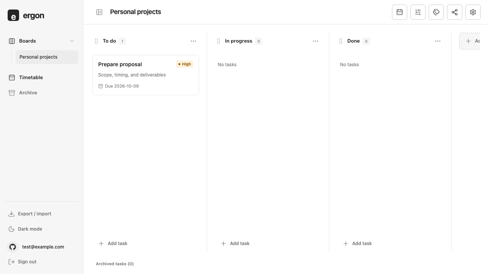
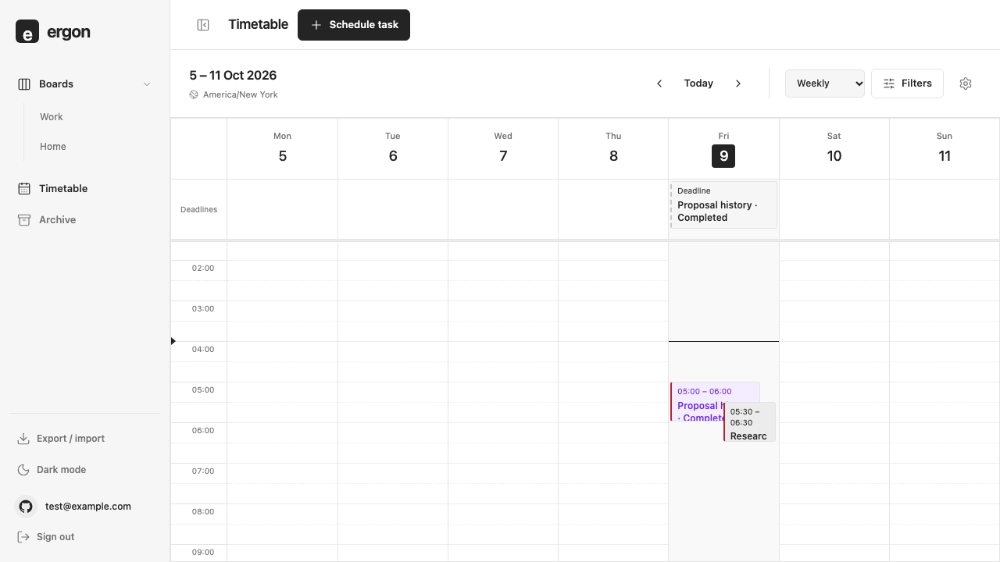
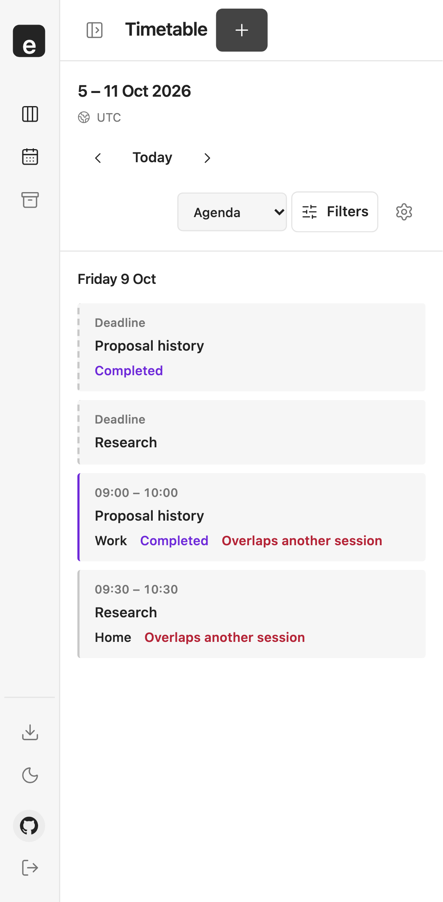
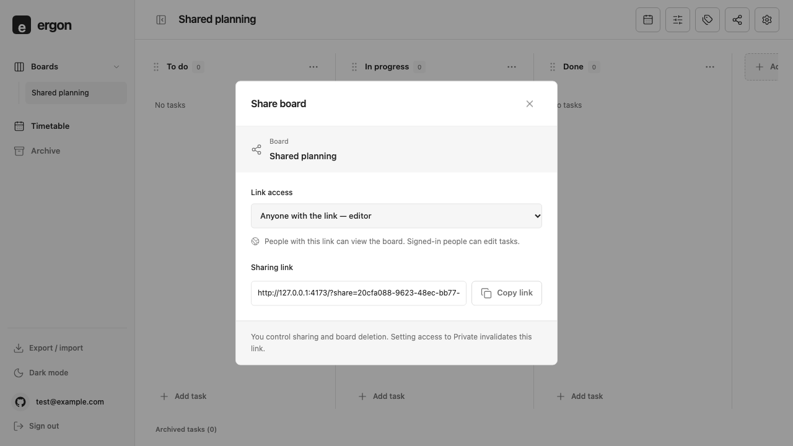
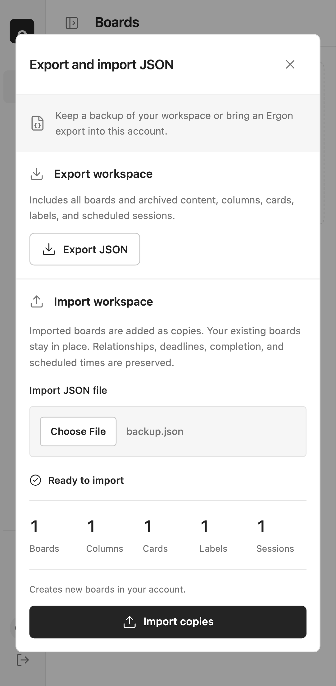

# Repository review

**Reviewed:** 29 October 2026 · **Branch:** `chore/final-repository-review`

## Verdict

Ergon has a substantial, coherent web implementation with strong automated coverage. The reviewed interface is consistent across desktop and mobile, and the main board, scheduling, sharing, and portability workflows are implemented. **The original project scope is not yet complete, and production readiness is not fully verified.** PWA installation and external task placement on the calendar remain missing; hosted acceptance and physical-device/accessibility checks remain release gates.

This review covers the local working tree, including the seven pre-existing modified/untracked UI and test files carried from `main`. Those edits were preserved. No deployment, schema changes, or commits were made during the review.

## Scope assessment

| Area                                              | Assessment                                    | Evidence                                                                                                       |
| ------------------------------------------------- | --------------------------------------------- | -------------------------------------------------------------------------------------------------------------- |
| GitHub authentication                             | Implemented; real consent/callback unverified | Auth provider/component tests; signed-out browser checks                                                       |
| Boards, columns, cards                            | Implemented                                   | CRUD, archive/restore, priority, ordering, keyboard movement, conflict and rollback tests                      |
| Search and labels                                 | Implemented                                   | Combined search/label/priority/completion filters; database relationship tests                                 |
| Scheduling                                        | Implemented                                   | Daily/weekly grids, agenda, multiple sessions, movement/resizing, preferences, overlap and DST tests           |
| Deadlines and completion                          | Implemented independently of scheduling       | Date-only deadlines, optional deadline times, retained session history                                         |
| Sharing                                           | Implemented                                   | Viewer/editor links, anonymous read restrictions, owner-only settings, revocation and isolation tests          |
| JSON portability                                  | Implemented                                   | Export, validation, import previews, relationship remapping and recovery tests                                 |
| PWA installation                                  | Missing                                       | No manifest, install assets, service worker, or registration in the application                                |
| Unscheduled-task panel and external calendar drop | Missing from current app                      | `Timetable.tsx` uses task-selection forms; no external draggable task source or receive handler                |
| Production/device acceptance                      | Incomplete                                    | Hosted test blocked by CLI authentication; Chromium emulation does not cover physical devices or other engines |

The calendar spike demonstrates external dragging in isolation; that does not establish its presence in the application. Either implement the two missing scope items or explicitly approve a smaller release scope. Optional extensions in the overview remain outside the core release.

## Verification

| Check                                               | Result                                                                                             |
| --------------------------------------------------- | -------------------------------------------------------------------------------------------------- |
| `npm run check`                                     | Passed: formatting, lint, TypeScript, 80 unit/component tests, 60 database tests, production build |
| `npm run test:e2e`                                  | Passed: 63 cases; 5 intentional device-specific skips; no failures                                 |
| Database type regeneration                          | Passed; generated file matches the checked-in types                                                |
| `git diff --check`                                  | Passed after edits                                                                                 |
| `npm run test:live`                                 | Blocked: Supabase CLI access token not provided; stopped before creating users/data                |
| Real GitHub OAuth / deployed acceptance             | Not run                                                                                            |
| Physical iOS/Android, Safari/Firefox, screen reader | Not run                                                                                            |

Database tests execute the migrations in PGlite with substituted identity plumbing. Browser tests use a simulated backend. These checks provide complementary evidence and do not prove deployed OAuth, network configuration, or cross-device persistence.

## Corrections made

- Replaced the stale README with a short project introduction, capabilities, setup, verification commands, project map, and explicit readiness limits.
- Reproduced a calendar boundary bug on both browser projects: at Sunday 23:30 UTC, a user in Tokyo opened Sunday's date/previous week even though their local date was Monday. Initial navigation now derives today from the saved timezone. A regression checks initial load, previous-period navigation, and Today.
- Stabilised the column-movement regression by waiting for the announced destination before capturing the drag and dropping. It previously dropped before movement was confirmed on mobile. Three repeated mobile runs passed with this assertion alone; no drag implementation change was retained.
- Clarified the outstanding calendar/PWA scope in the overview and architecture.

## UI/UX walkthrough

Screenshots below are from this review's production-build Playwright runs using synthetic data. They are separate checked states, rather than a single continuous user session.

1. **Board workspace — healthy.** Neutral surfaces, aligned columns, compact priorities, and clear navigation keep task content prominent. Horizontal scrolling is contained; mobile shows part of the next column. Long board names truncate on narrow screens, so the full title is less immediately discoverable.

   

2. **Calendar — functional, with density limits.** Deadlines remain separate from sessions; completed work and overlaps retain their meaning. Short overlapping grid sessions truncate titles and compete for space. Details are available through the editor; the agenda is the clearer reading view for dense schedules.

   

3. **Mobile agenda — healthy.** Readable task names, labelled overlap warnings, and visible scheduling controls provide a usable alternative to the grid. The toolbar consumes several rows even with the sidebar collapsed, leaving less room for the agenda on short screens.

   

4. **Sharing — healthy.** The access selector states who can read/edit, and the revocation explanation is adjacent to the link. A native selector and selectable link provide accessible control foundations. Real clipboard permission failures and OAuth return navigation still need deployed-device acceptance.

   

5. **Import/export — healthy.** A labelled file input, preview counts, explicit copy semantics, and a distinct import action make the operation understandable. The mobile layout stacks naturally; browser tests cover keyboard activation, invalid files, failure/retry, Escape, and focus return.

   

Automated keyboard checks cover card/column sorting, modal editing, date picking, forms, and focus restoration. Screenshots alone do not establish contrast compliance, touch-target adequacy at every size, or screen-reader usability. No full accessibility-conformance claim is made.

## Remaining work, in order

1. **Close scope:** implement installation with application-shell-only caching and the original external task-placement flow, or record an explicit scope reduction. Never cache authenticated responses as part of PWA work.
2. **Verify the hosted system:** authenticate the Supabase CLI and run `npm run test:live`; then verify real GitHub sign-in/reload/logout, sharing revocation, two-user isolation, stale edits, and cross-device persistence on the deployment. Follow the [deployment guide](deployment.md).
3. **Complete device/accessibility acceptance:** physical iOS/Android, Safari/Firefox, keyboard navigation, screen-reader announcements, zoom, contrast, dense content, and touch interactions. Retain form alternatives to drag gestures.
4. **Resolve quality warnings:** lint reports two synchronous state updates in timetable effects and a Fast Refresh warning in the calendar spike. The initial production JavaScript chunk is approximately 601 kB minified (173 kB gzip), above Vite's 500 kB warning threshold. Measure loading on slower devices before selecting a split; the timetable is already lazy-loaded.

The local automated result is a readiness signal. Release approval still requires the missing implementation or scope decision and the external checks above.
